<h1 align="center">
  <a href="https://drinkcrabigator.com">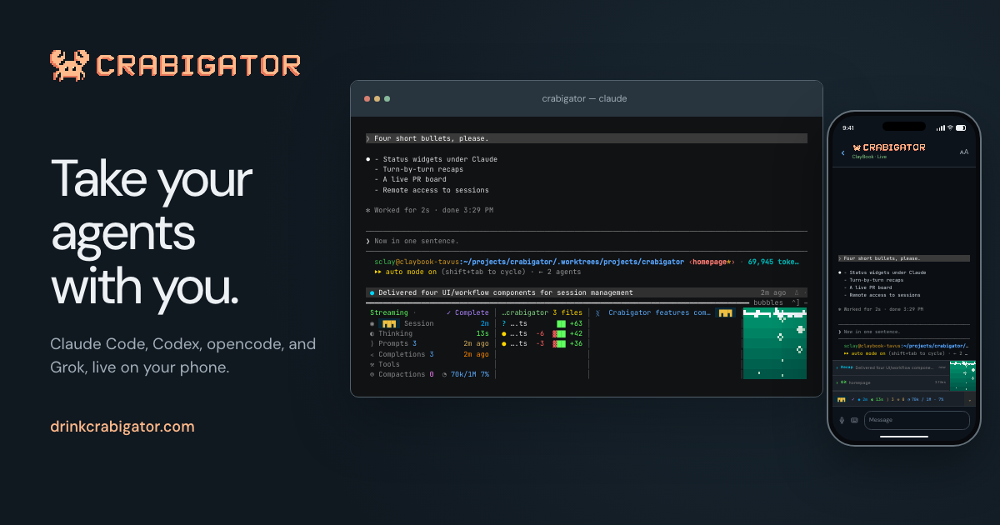</a>
</h1>

<p align="center">
  <b>Claude Code, Codex, opencode, and Grok, live on your phone.</b><br>
  Crabigator runs your coding agent in your terminal, unchanged, and adds what it doesn’t show.<br>
  Follow and answer every session from your phone, your tablet, or a browser tab.
</p>

<p align="center">
  <a href="https://www.npmjs.com/package/crabigator"></a>
  <a href="LICENSE"></a>
</p>

<p align="center">
  <a href="https://drinkcrabigator.com">Website</a> ·
  <a href="https://drinkcrabigator.com/dashboard">Dashboard</a> ·
  <a href="#install">Install</a> ·
  <a href="#commands">Commands</a> ·
  <a href="#self-host-the-cloudflare-worker">Self-host</a>
</p>

## Install

```bash
npm install -g crabigator
```

Then run it in place of your agent:

```bash
crabigator            # Claude Code (or your default)
crabigator codex      # Codex
crabigator opencode   # opencode
crabigator grok       # Grok
```

The first time, Crabigator shows a pairing link. Open it on your phone, and your sessions stream to the [dashboard](https://drinkcrabigator.com/dashboard) and the apps from then on.

You need one of the agents installed and signed in, and Node.js 18 or later. Crabigator runs on macOS, Linux, and Windows. To build from source instead, use Rust:

```bash
git clone https://github.com/samuelclay/crabigator.git
cd crabigator
cargo install --path .
```

## Claude Code, unchanged

<p align="center">
  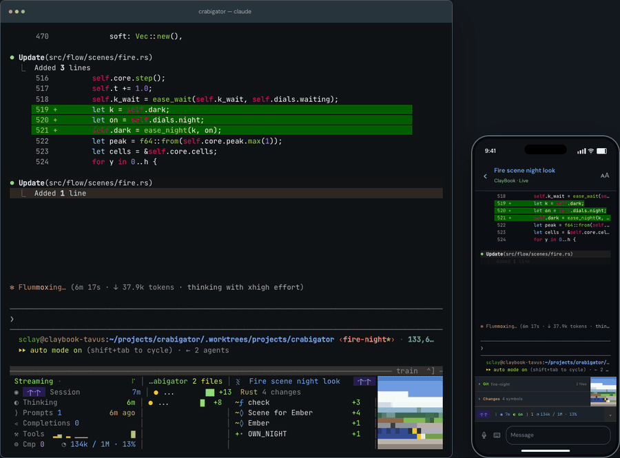
</p>

Crabigator runs the agent’s own command in your terminal, so it looks and behaves as it always does, and updates when the agent does. Below it, a status bar shows:

- **Stats**: how long the session has worked and thought, prompts and completions, tool calls, and how full the context window is.
- **Git**: the branch and every file changed, with lines added and removed.
- **Changes**: the functions and classes the session touched, for Rust, TypeScript, Python, Swift, and Objective-C.
- **Flow**: a small scene that moves with the work. See [A scene for every session](#a-scene-for-every-session).

Above the status bar sit the latest recap and the pull requests the session is working on.

## Codex, too

<p align="center">
  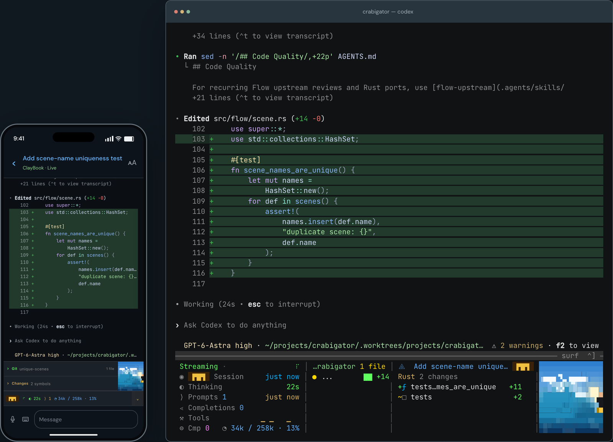
</p>

The same status bar and apps work with [Codex](https://github.com/openai/codex), [opencode](https://opencode.ai), and [Grok](https://grok.com). Crabigator follows each agent through its own logs and events, so there’s nothing to set up.

## Your sessions, on every screen

<table>
  <tr>
    <td width="50%" align="center">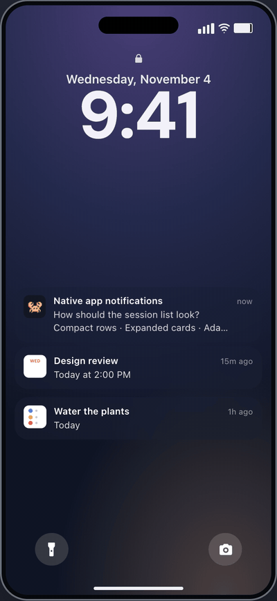</td>
    <td width="50%" align="center">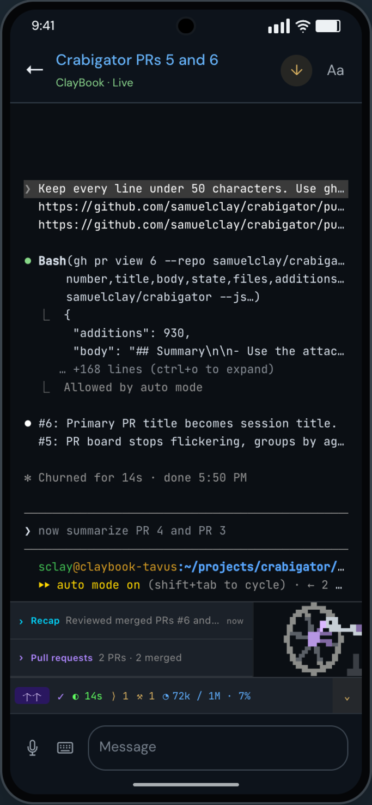</td>
  </tr>
  <tr>
    <td><b>Answer from the notification.</b> No need to unlock. Permission requests, questions, and plan approvals arrive with their choices.</td>
    <td><b>Android, too.</b> The same terminal, modules, and replies.</td>
  </tr>
</table>

<p align="center">
  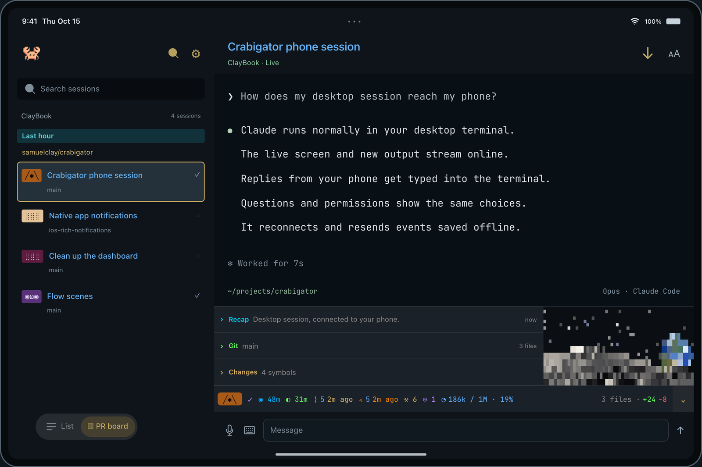
</p>

<p align="center"><b>Read, scroll back, and reply.</b> Type or speak your next instruction.</p>

<p align="center">
  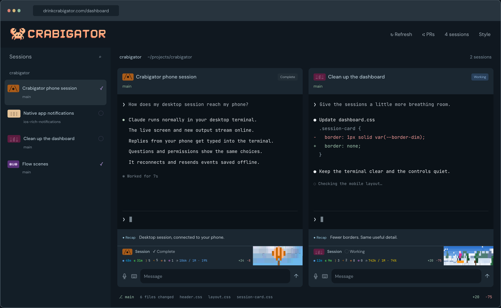
</p>

<p align="center"><b>Every session in a browser tab.</b> Nothing to install: open the <a href="https://drinkcrabigator.com/dashboard">dashboard</a>.</p>

Sessions from all your computers show up together, each computer with its own name and color. If the connection drops, events wait on your computer and send when it returns.

## More in every session

### A recap after every turn

<p align="center">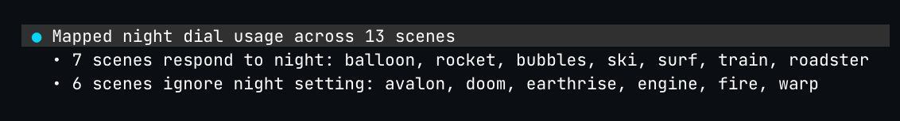</p>

After each turn, a short recap says what changed, so you don’t have to scroll back. It shows in the terminal, on the dashboard, in the apps, and on the PR board. Recaps are written on your computer from your own transcript, with your Anthropic API key, and only the finished recap goes to the cloud. Turn them on with `crabigator recap enable`.

### Pull requests, tracked

<p align="center">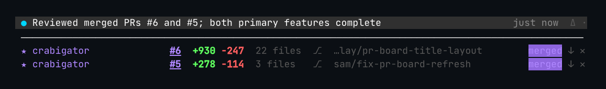</p>

Each session lists the pull requests it opened or worked on, with their status. `crabigator prs` gathers them into one live board across all your sessions, and your other computers. It opens on the last 24 hours, with each session as a block and its pull requests beneath it.

Board keys:

- `s`: switch between sessions and pull requests. In pull request view, each primary PR is a block, with every session that touched it beneath.
- `↑` `↓`: select a row. `Enter` opens a quick look at that session’s live screen, even on another computer. While it’s open, `↑` `↓` scroll its transcript, `←` `→` switch sessions, and `f` opens it full screen so you can type into it.
- `/`: search, including the text of each live session’s transcript. `Tab` shows more around each match.
- `w`: watch any pull request by URL or `owner/repo#123`. Typing `track PR <url>` in a session does the same.
- `l`: live sessions, or every session including ended ones.
- `o`: this computer only, or every computer on your account.
- `r`: show or hide recaps. `a`: change how far back the board looks.

The board remembers these choices. The [dashboard’s PR board](https://drinkcrabigator.com/dashboard) shows the same thing on the web.

### A scene for every session

<p align="center">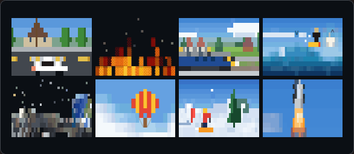</p>

Fifteen scenes, each moving with the work: roadster, fire, train, surf, earthrise, balloon, ski, starship, and more. They speed up while the agent works, settle while it waits for you, and turn blue when the context window is nearly full. Each new session picks its own scene, in the session’s color, and the dashboard and apps show the same one.

- Press `ctrl+]` to cycle through scenes, then Settings, then Off.
- Settings is a checklist: uncheck scenes you don’t want. Leave one checked to use it in every session. Below the list, choose whether scenes fade, a fixed activity level, day or night, and colors. Select Save and press `Enter`.
- In a tall terminal, the status bar grows (up to a fifth of the terminal) so the scene can stand up and run vertically.

The scenes are a Rust port of Rob Macrae’s [flow](https://github.com/robdmac/flow).

### An MCP server for your agents

<p align="center">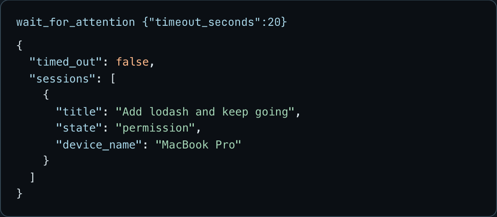</p>

Any MCP client can read your sessions and answer their prompts: list sessions, read screens and scrollback, send input, choose options, and drive the PR board. Point the client at:

```
https://drinkcrabigator.com/mcp
```

It signs in with GitHub or Google. If your account has no computer paired yet, enter a code from `crabigator pair`. This works with Claude Desktop, Claude.ai connectors, Cursor, Grok, and the [MCP Inspector](https://modelcontextprotocol.io/docs/tools/inspector). In Grok:

```bash
grok mcp add --transport http crabigator https://drinkcrabigator.com/mcp
```

Then open `/mcps` and press `i` to sign in. Every tool, with example output, is listed at [drinkcrabigator.com/mcp-tools](https://drinkcrabigator.com/mcp-tools). To check whether a call reached the server, call `get_mcp_logs` and match the client’s `X-Mcp-Request-Id` header to `request_id`. Sessions that never stream to the cloud don’t appear, here or on the website.

## Still your terminal

- The agent runs in a real terminal session on your computer, with all its keys and shortcuts.
- Your terminal keeps its scrollback and text selection, and Option+Arrow moves by word.
- File paths become links that open in your editor (set `ide` in the config).
- Free and open source: MIT licensed and written in Rust. Use the hosted dashboard, or [run your own](#self-host-the-cloudflare-worker).

On a Mac with Ghostty, new sessions start in the background while the display sleeps, so you can use them from the dashboard right away. Ghostty attaches when the display wakes. This needs [tmux](https://github.com/tmux/tmux/wiki) (`brew install tmux`), and the Mac must stay awake and online.

## How it works

```
┌─────────────────────────────────────┐
│                                     │
│     Claude Code, Codex, opencode,   │  ← The agent's own command,
│     or Grok                         │    running as normal
│                                     │
├─────────────────────────────────────┤
│ Recap · Pull requests               │
│ Stats │ Git │ Changes │ Flow        │  ← Crabigator's status bar
└─────────────────────────────────────┘
                 │
                 ▼
        ┌─────────────────┐
        │   Cloud relay   │  ← Official, or your own Cloudflare Worker
        └─────────────────┘
                 │
                 ▼
     Phone · tablet · browser · MCP
```

Crabigator starts the agent in a pseudo-terminal and keeps its output in the top part of your terminal, using the terminal’s own scroll region. It draws the status bar below with plain escape codes. The session streams to a Cloudflare Worker over a WebSocket, which passes it to the dashboard, the apps, and MCP clients, and reconnects on its own.

## Commands

```bash
crabigator                    # Start with your default agent
crabigator claude             # Claude Code
crabigator codex              # Codex
crabigator opencode           # opencode
crabigator grok               # Grok (also: grok-build, xai)
crabigator resume             # Resume the last session (also: r, --resume)
crabigator continue           # Continue the last conversation (also: c, --continue)

crabigator prs                # Live PR board across sessions
crabigator prs --once         # Print the board once and exit

crabigator inspect            # List running sessions on this computer
crabigator inspect /path      # Only sessions in this folder
crabigator inspect --watch    # Keep watching
crabigator inspect --raw      # Raw JSON
crabigator inspect --history  # Hook event history, for debugging

crabigator recap enable       # Turn on recaps (asks for an API key)
crabigator recap disable      # Turn off recaps and remove the saved key
crabigator recap status       # Show recap settings
crabigator key <api-key>      # Save an Anthropic API key for recaps

crabigator cloud status       # Show which cloud service is in use
crabigator cloud set <origin> # Use your own Worker (checks it first)
crabigator cloud reset        # Go back to the official service

crabigator pair               # Show a pairing code for the dashboard
crabigator install-launcher   # Install the macOS crabigator:// link handler
crabigator --no-capture       # Don't write scrollback.log or screen.txt
```

Any other arguments go straight to the agent. Codex starts in inline mode (`--no-alt-screen`), so you can scroll back and select text without holding Shift, including when you resume or continue.

## Configuration

Preferences live in `~/.crabigator/config.toml`:

```toml
default_platform = "claude"   # or "codex", "opencode", "grok"
ide = "vscode"                # file links: vscode, cursor, idea, zed, sublime, none
terminal = "ghostty"          # terminal, ghostty (detected when unset)
check_for_updates = true      # check GitHub Releases on startup
recap_enabled = true          # recaps (needs an API key: crabigator key)
recap_model = "claude-haiku-4-5"  # optional model for recaps

[cloud]
# url = "https://crabigator.example.com" # omit to use the official service

[flow]
enabled = true                # ctrl+] cycles scenes, Settings and Off
fade = false                  # brighten at each change, then fade over two minutes
color = "session"             # session, natural, or a named hue such as violet
# disabled_scenes = ["doom", "doom3d"] # left out when picking and cycling
# level = 7                   # omit to follow activity; 0–10 holds a level
# night = true                # omit for the local time; true = night, false = day

[pr_board]                    # saved by crabigator prs
include_ended = false         # true also shows ended sessions
include_remote = true         # include your other computers
detail = 0                    # 0 compact, 1 full recaps
oldest_visible_hours = 24     # how far back; 0 shows everything
view = "sessions"             # "sessions" or "prs"
```

`crabigator cloud set` takes an HTTPS origin, or HTTP for local development such as `http://localhost:8787`. It checks `/api/health` before saving. Use `--force` only when the service is down for a while but you know it works.

Each custom host keeps its own device identity, pairing, and offline queue under `~/.crabigator/cloud/<origin-hash>/`. The official service keeps its files directly in `~/.crabigator/`. Switching hosts doesn’t copy devices or sessions between them.

For Claude Code, Crabigator installs hooks in `~/.claude/crabigator/` to follow the session’s state. They carry a version and reinstall themselves when Crabigator updates.

## Self-host the Cloudflare Worker

The Worker in `workers/crabigator-api/` holds the relay, dashboard, pairing, Durable Objects, D1 database, and KV-backed tokens. A basic deployment needs only a Cloudflare account. Optional features stay off until you turn them on and configure them.

### 1. Create your configuration

```bash
cd workers/crabigator-api
npm install
cp wrangler.example.jsonc wrangler.jsonc
```

`wrangler.example.jsonc` is the annotated template. `wrangler.jsonc` is ignored by Git, so it can hold your account’s resource IDs, routes, and public settings. Don’t put API keys in either file.

The example deploys to `workers.dev`. For a custom domain, set `workers_dev` to `false` and add:

```jsonc
"routes": [
  { "pattern": "crabigator.example.com", "custom_domain": true }
]
```

Set `APP_CONFIG.public_origin` to your final HTTPS origin if you turn on email, payments, or traffic alerts. Otherwise leave it blank, and pages use the request’s origin.

### 2. Develop and migrate locally

```bash
npm run db:migrate:local
npm run dev
curl http://localhost:8787/api/health
```

Wrangler uses local D1, KV, and Durable Object storage, and applies every migration in `migrations/` in order.

### 3. Deploy and migrate production

```bash
wrangler login
npm run deploy
npm run db:migrate:remote
curl https://your-worker.example/api/health
```

The template leaves out D1 and KV IDs, so Wrangler can create and bind them on the first deploy. Keep every Durable Object migration entry in the template: removing old entries can break an existing deployment.

To use another config or Wrangler profile without editing scripts:

```bash
WRANGLER_CONFIG=wrangler.staging.jsonc WRANGLER_PROFILE=my-profile npm run deploy
```

`wrangler.production.jsonc` is the official drinkcrabigator.com deployment’s config. It’s here as a working reference, but it names that account’s resources and routes, so it deploys only with that account’s profile.

### 4. Connect your computer

```bash
crabigator cloud set https://your-worker.example
crabigator cloud status
crabigator pair
```

Open the dashboard link Crabigator shows and enter the pairing code. `crabigator cloud reset` goes back to the official service.

The Worker’s `test-state.sh`, `test-events.sh`, and `test-answer.sh` helpers use the same cloud URL and device identity. Set `CLOUD_URL` and `CRABIGATOR_STATE_DIR` only to test without an installed `crabigator`.

### Optional features

Turn a feature on in `APP_CONFIG.features`, then add its secrets with `wrangler secret put NAME`. A feature stays off until all its values exist. `/api/health` lists what’s on and what’s missing.

| Feature | Public configuration | Secrets |
|---|---|---|
| Relay, dashboard, pairing, PR board | None | None |
| Voice transcription | `features.transcription` | `OPENAI_API_KEY` |
| Billing | `features.billing`, display price, provider mode, and visible-session limit | Stripe live or test keys, or PayPal client, secret, webhook ID, and plan ID |
| Gifts | `features.gifts` and billing | The billing provider’s values |
| Gift email | `features.outbound_email`, Mailgun domain and sender | `MAILGUN_API_KEY` |
| Marketing analytics | `features.marketing_analytics`; optional Meta Pixel ID | None |
| Traffic alerts | `features.traffic_alerts`, public origin, Mailgun values, alert recipient | `MAILGUN_API_KEY` |
| Release emails to newsletter signups (`make announce-release`) | `features.outbound_email`, `features.marketing_analytics`, public origin, Mailgun values; optional `email.releases_from` | `MAILGUN_API_KEY` |
| Staff tools | `features.staff` | `STAFF_ACCESS_KEY` |

Use a long, random `STAFF_ACCESS_KEY`. The `/staff` login creates a 12-hour, Secure, HttpOnly, SameSite=Strict session in KV. Changing the key signs out every staff session, and staff changes must come from the same origin.

Stripe secrets are `STRIPE_SECRET_KEY`, `STRIPE_WEBHOOK_SECRET`, and `STRIPE_PRICE_ID`, with `_TEST` added for test mode. PayPal secrets are `PAYPAL_CLIENT_ID`, `PAYPAL_CLIENT_SECRET`, `PAYPAL_WEBHOOK_ID`, and `PAYPAL_PLAN_ID`.

## Session files

Each session writes to `/tmp/crabigator-{session_id}/`:

- `scrollback.log`: the transcript, built from the agent’s own log.
- `screen.txt`: the current screen.
- `inspect.json`: the status bar’s state, for other tools (`crabigator inspect` reads it).
- `hooks.log`: hook calls (Claude Code).

## Architecture

The desktop app is Rust; the cloud side is a Cloudflare Workers project. [AGENTS.md](AGENTS.md) has the full module map. The main parts:

| Area | Where | What |
|------|-------|------|
| App loop | [`src/app.rs`](src/app.rs) | Scroll region layout, events, terminal passthrough |
| Terminal | [`src/terminal/`](src/terminal.rs) | Pseudo-terminal, keyboard input, escape codes |
| Status bar | [`src/ui/`](src/ui.rs) | Stats, git, changes, flow, the recap and PR strip, pairing banners |
| Flow scenes | [`src/flow/`](src/flow.rs) | The scenes, ported from [flow](https://github.com/robdmac/flow) ([fork log](src/flow/FORK.md)) |
| Scene library | [`crates/flow-render/`](crates/flow-render/) | The same scenes for the apps (iOS, Android) and the dashboard (WebAssembly) |
| Diff parsing | [`src/parsers/`](src/parsers.rs) | Changes by function and class, per language |
| Agents | [`src/platforms/`](src/platforms.rs) | Claude Code hooks and transcripts; Codex, opencode, and Grok session logs |
| Recaps and PRs | [`src/recap.rs`](src/recap.rs), [`src/pr.rs`](src/pr.rs), [`src/prs_board.rs`](src/prs_board.rs) | Recaps, pull request tracking, the `prs` board |
| Cloud client | [`src/cloud/`](src/cloud.rs) | Device identity, signed requests, event queue, WebSocket |
| Cloud | [`workers/crabigator-api/`](workers/crabigator-api/) | Durable Objects, D1, dashboard, homepage, MCP server |
| Apps | [`clients/ios/`](clients/ios/), [`clients/android/`](clients/android/) | The iPhone, iPad, and Android apps |

## Why “Crabigator”?

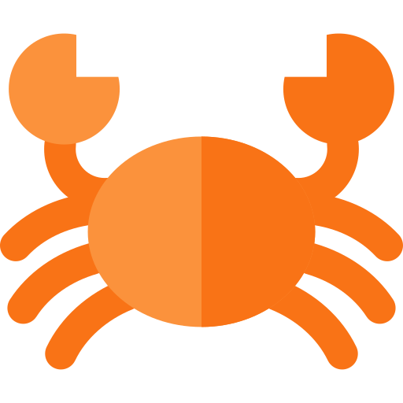 It’s a quadruple pun:

- **Claude**: the AI it first wrapped.
- **Navigator**: it steers your sessions.
- **Crab**: Rust’s mascot is Ferris the crab.
- **Alligator**: named after the late Claude, the beloved albino alligator at the California Academy of Sciences.

## Contributing

Pull requests are welcome.

```bash
cargo build              # Debug build (make run starts it)
cargo test               # Tests (update fixture snapshots with make test-update)
cargo clippy             # Lint

cd workers/crabigator-api
npm run dev              # Local Worker and dashboard
```

## License

MIT. See [LICENSE](LICENSE). The flow scenes in `src/flow/` are ported from Rob Macrae’s [flow](https://github.com/robdmac/flow), also MIT ([src/flow/LICENSE](src/flow/LICENSE)).

---

<p align="center">
  <a href="https://drinkcrabigator.com">drinkcrabigator.com</a> ·
  <a href="https://github.com/samuelclay/crabigator/issues">Report a bug</a> ·
  <a href="https://github.com/samuelclay/crabigator/issues">Request a feature</a>
</p>
